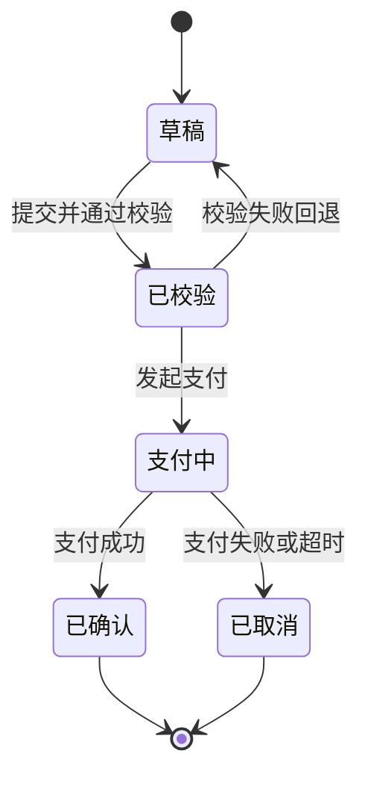

# 七层设计链落盘骨架

> 本文件是七层设计链的最小可运行骨架。所有 `.c4` 代码块均经 likec4 1.58.0 实测通过。
> 规则、边界与追溯门禁见 `references/07-seven-layer-design.md`。
> 业务状态机（I 层核心产出）走 Mermaid `stateDiagram-v2`，LikeC4 不支持状态机。

## 文件布局

```text
src/
  specification.c4       六层 element kind 定义
  model/
    us.c4                US 用户故事
    framework.c4         F 功能框架 + NF 非功能框架
    implementation.c4    I 实现层：业务目标 / 状态 / 步骤
    ui.c4                UI 界面层：交互设计 + 信息设计
    src.c4               SRC 源码层
  views/
    chain.c4             必备五个视图
  states/                I 层业务状态机（Mermaid，非 LikeC4）
    <us-id>-state.md
```

---

## src/specification.c4

```c4
specification {
  element userStory {
    style {
      shape document
    }
  }
  element function {
    style {
      shape rectangle
    }
  }
  element nonFunction {
    style {
      shape mobile
    }
  }
  element implStep {
    style {
      shape rectangle
    }
  }
  element uiSurface {
    style {
      shape browser
    }
  }
  element srcUnit {
    style {
      shape component
    }
  }
  element system
}
```

`shape` 合法值仅限：`rectangle` `component` `storage` `cylinder` `browser` `mobile` `person` `queue` `bucket` `document`。**无 `hexagon`**。

---

## src/model/us.c4

```c4
model {
  us_checkout = userStory 'US-001 结算下单' {
    description '作为客户，我希望完成一次可追踪的结算下单，以便获得明确的订单确认。'
  }
}
```

编号格式 `US-<三位编号> <标题>`，全局唯一，不复用。

---

## src/model/framework.c4

```c4
model {
  f_order = function 'F-001 订单功能' {
    description '承载订单创建、校验与确认的功能框架。'
  }
  f_payment = function 'F-002 支付功能' {
    description '承载支付发起与结果处理的功能框架。'
  }
  nf_auditability = nonFunction 'NF-001 可审计性' {
    description '所有状态变更留痕，可按订单号回溯。'
  }
  nf_latency = nonFunction 'NF-002 响应时延' {
    description '下单请求 P95 不超过既定阈值。'
  }

  us_checkout -> f_order '要求'
  us_checkout -> f_payment '要求'
  us_checkout -> nf_auditability '要求'
  us_checkout -> nf_latency '要求'
}
```

NF 项必须可度量。无法度量的写 `待补充`，不编造指标。

---

## src/model/implementation.c4

```c4
model {
  i_goal = implStep 'I-001 业务目标' {
    description '目标：客户在一次会话内完成下单，且状态可回溯。'
  }
  i_state = implStep 'I-002 业务状态' {
    description '状态：草稿 → 已校验 → 支付中 → 已确认 / 已取消。详见 states/US-001-state.md'
  }
  i_step = implStep 'I-003 业务步骤' {
    description '步骤：提交订单 → 校验库存 → 发起支付 → 确认或回滚。'
  }

  f_order -> i_goal '实现目标'
  f_order -> i_state '实现状态'
  f_order -> i_step '实现步骤'
  nf_auditability -> i_state '约束状态迁移'
  nf_latency -> i_step '约束步骤耗时'
}
```

**本层禁止出现**类名、函数名、表名、文件名。一旦出现即越界到 SRC 层。

判据：换个人、换技术栈，这层设计依然成立。

---

## src/model/ui.c4

```c4
model {
  ui_interaction = uiSurface 'UI-001 交互设计' {
    description '提交后按钮置灰并显示进度；失败时回退到可编辑状态；支付结果可撤销。'
  }
  ui_information = uiSurface 'UI-002 信息设计' {
    description '字段：订单号、金额、状态、时间。列表区展示历史订单，筛选区按状态与时间过滤，通知区提示支付结果。'
  }

  i_step -> ui_interaction '反馈'
  i_state -> ui_information '展示状态'
}
```

交互设计与信息设计**两类都要有**，缺一即为不完整。

信息设计必须覆盖四种状态：空状态、加载状态、错误状态、无权限状态。

---

## src/model/src.c4

```c4
model {
  src_checkout = srcUnit 'SRC-001 结算入口' {
    description 'src/routes/checkout-routes.js — 接收下单请求并派发。'
  }
  src_orderService = srcUnit 'SRC-002 订单服务' {
    description 'src/services/order-service.js — 订单状态机与校验。'
  }
  src_paymentClient = srcUnit 'SRC-003 支付客户端' {
    description 'src/services/payment-client.js — 调用支付网关。'
  }

  ui_interaction -> src_checkout '触发'
  ui_information -> src_orderService '读取'
  src_checkout -> src_orderService '调用'
  src_orderService -> src_paymentClient '调用'
}
```

**每个 SRC 单元必须绑定真实文件路径**。写不出路径说明该单元尚未实现，标 `待补充`。

反向检查：每个 SRC 单元应能回答「它服务于哪个 I 步骤或 UI 元素」。答不上即为超范围实现。

---

## src/views/chain.c4

```c4
views {
  view chainOverview {
    title '设计链路总览'
    description '一个用户故事贯穿功能框架、实现层、界面层与源码层的完整设计链。'
    include *
  }

  view chainBusiness {
    title '业务设计视角（不含源码）'
    description 'US 到 UI 层的业务设计，供业务方确认。不含任何源码元素。'
    include us_checkout
    include f_order, f_payment
    include nf_auditability, nf_latency
    include i_goal, i_state, i_step
    include ui_interaction, ui_information
  }

  view chainSource {
    title '源码实现视角'
    description 'I 层落到 SRC 层的映射，每个源码单元对应真实文件路径。'
    include i_goal, i_state, i_step
    include ui_interaction, ui_information
    include src_checkout, src_orderService, src_paymentClient
  }

  view chainFrame {
    title '功能与非功能框架'
    description 'US 驱动的 F 与 NF 框架。'
    include us_checkout
    include f_order, f_payment
    include nf_auditability, nf_latency
  }

  dynamic view chainSequence {
    variant sequence
    title '下单设计时序'
    description '从用户提交到支付确认的步骤序列。'
    include us_checkout, f_order, i_step, ui_interaction
    include src_checkout, src_orderService, src_paymentClient

    us_checkout -> f_order '提出下单'
    f_order -> i_step '执行业务步骤'
    i_step -> ui_interaction '反馈交互'
    ui_interaction -> src_checkout '触发源码'
    src_checkout -> src_orderService '调用'
    src_orderService -> src_paymentClient '支付'
  }
}
```

**三条实测约束**：

1. `include f_*` 通配符**不支持** → 必须逐个列出
2. `dynamic view` 若只有 `include` 没有消息 → 布局报 `actors array must not be empty`，且 **`likec4 validate` 仍通过**。必须跑 `build` 才能发现
3. `variant sequence` 只可连接叶子元素

---

## states/US-001-state.md（I 层状态机，Mermaid）



LikeC4 1.58.0 不支持状态机（`opt` `loop` `alt` `try` 均不可用）。业务状态机是 I 层核心产出，必须走 Mermaid。

状态迁移条件必须可审计：每个迁移标注触发条件，满足 NF-001 可审计性要求。

---

## 交付检查

- [ ] 每个 US 链路完整：US → F/NF → I → UI → SRC
- [ ] I 层无源码元素（无类名、函数名、表名、文件名）
- [ ] 每个 SRC 单元绑定真实文件路径
- [ ] 交互设计与信息设计都有产出
- [ ] 信息设计覆盖空/加载/错误/无权限四种状态
- [ ] NF 项均可度量，不可度量的已标 `待补充`
- [ ] 业务状态机走 Mermaid 而非 LikeC4
- [ ] `likec4 validate` 通过
- [ ] `likec4 build` 通过（validate 不足以发现布局错误）
- [ ] `likec4 format --check` 通过
- [ ] 业务设计视角视图已排除 SRC 元素
- [ ] 构建部署图未产出，或已说明为何此时产出
